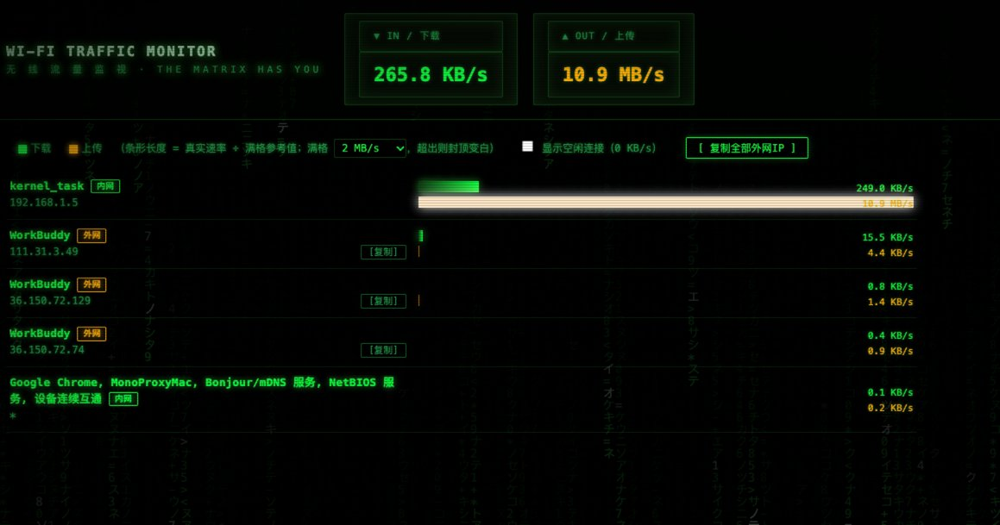

<div align="center">

# 🟢 WiFiMatrix

**macOS 实时 Wi-Fi 流量看板 · 黑客帝国风格**

一眼看清本机 Wi-Fi 的上传 / 下载流量都去了**哪些地址、哪些程序**

`纯本地运行` `零依赖运行时` `单文件源码` `原生独立窗口`


</div>

---

## 📸 预览



> 纯黑底 + 母体绿代码雨 + CRT 扫描线；下载=绿、上传=琥珀、错误=Matrix 红

## ✨ 功能特性

- **真实应用名**：显示进程对应的真实应用（如 `Electron` → `WorkBuddy`），系统守护进程给出中文说明（如 `apsd` → 苹果推送服务、`rapportd` → 设备连续互通）
- **内网 / 外网标注**：IPv4 / IPv6 全支持（含 ULA、链路本地、`%zone` 作用域地址）
- **一键复制 IP**：每个外网 IP 单独复制，或「复制全部外网 IP」批量导出，拿去别处查询
- **绝对刻度进度条**：满格参考值可调（256 KB/s ~ 50 MB/s），小流量不"假撑满"，条形长度即真实速率比例
- **空闲连接开关**：默认只看有流量的连接
- **错误可见**：nettop 采样失败时界面红字报错，绝不静默假数据

## 💻 系统要求

| 项目 | 要求 |
|---|---|
| 系统 | **macOS 13 (Ventura) 及以上**（在 macOS 27.2 上构建与实测） |
| 权限 | 无需 sudo；无需辅助功能/屏幕录制等授权 |
| 网络 | 无要求 —— 应用本身**不发起任何网络请求**（见隐私说明） |
| 磁盘 | 应用约 25 MB |
| 限制 | 仅监控 **Wi-Fi 接口**的流量（有线 / 热点共享不在统计范围） |

## 📦 安装

### 方式一：下载 DMG（推荐）

从 [**Releases**](../../releases) 页面下载最新的 `WiFiMatrix-1.3.0.dmg`：

1. 打开 DMG，将 **WiFiMatrix** 拖入 `Applications`
2. 首次打开如果弹出 **"无法验证开发者"**：
   - 在 `Applications` 中**右键点击 WiFiMatrix → 打开 → 再点"打开"**（只需一次）
   - 或者终端执行（二选一）：
     ```bash
     xattr -dr com.apple.quarantine /Applications/WiFiMatrix.app
     ```

> **为什么会有这个提示？** 本应用为开源免费项目，未做签名公证。这**不代表应用有问题**——所有代码开源可审计。只有「从网上下载」的文件才会带隔离标记；U 盘 / git clone / 内网传输的副本不会弹任何警告。

### 方式二：源码运行（无需打包）

```bash
git clone https://github.com/12monthsproject/WiFiMatrix.git
cd WiFiMatrix
python3 wifi_monitor.py
```

- 依赖：仅 Python 3 标准库（macOS 自带，或 [python.org](https://www.python.org/downloads/) / Homebrew 安装）
- 此模式通过浏览器访问看板（自动打开 `http://127.0.0.1:<随机端口>`）
- 想要原生独立窗口：`pip3 install pywebview` 后重新运行即可

### 方式三：从源码打包 .app / DMG

```bash
cd WiFiMatrixApp
./build_app.sh
```

脚本全自动：创建 venv → 安装 pywebview + pyinstaller → 生成图标 → 打包 .app → 写入版本号 → 签名 → 制作 DMG。产物为 `WiFiMatrixApp/dist/WiFiMatrix.app` 与 `WiFiMatrixApp/WiFiMatrix-1.3.0.dmg`（版本号在脚本顶部 `APP_VERSION` 配置）。

## 🔒 隐私说明

- **本应用不发起任何网络请求**，不做任何在线 IP 归属地查询，不上传任何数据
- 所有流量数据来自 macOS 系统自带的 `nettop` 工具在本机的采样，只在本地内存中处理
- 看板 Web 服务只绑定 `127.0.0.1`，仅本机可访问

## ⚙️ 工作原理

```
nettop（系统自带）─采样─▶ CSV 自适应解析（列序无关）─▶ 按 IP+应用聚合差值速率 ─▶ 本地看板
                                                              │
                              随机端口本地 HTTP → 原生窗口 / 浏览器
```

- 采样：`nettop -n -L 2 -t wifi -J bytes_in,bytes_out,interface,state`，CSV 解析**不依赖列序**（在整行中识别连接字段与纯数字字节列）
- 速率：相邻两轮累计字节差 ÷ 真实时间差
- 短连接（DNS、瞬时请求）：窗口内新建的连接按累计字节全额计入，不漏统计
- 应用名：`ps` 提取进程的 `.app` 包名 + 内置系统守护进程中文映射表

## ❓ FAQ

**Q: 看板显示「当前无活跃流量」？**
默认隐藏 0 KB/s 的空闲连接，勾选「显示空闲连接」可查看全部。

**Q: 为什么没有显示 IP 所属国家/地区？**
免费在线 GeoIP 源不可靠（限流/被墙），为避免反复请求触发封禁，暂未内置。可以点「复制」按钮把 IP 拿到任意查询工具查看。

**Q: 速率和我感受的对不上？**
看板统计的是 **Wi-Fi 接口上每条连接**的速率，不包含局域网有线流量；部分系统进程的流量可能归属到聚合条目中。

**Q: 关闭窗口后会继续在后台跑吗？**
不会，关闭窗口即完全退出，不留后台进程。

## 📁 项目结构

```
WiFiMatrix/
├── wifi_monitor.py            # 全部源码（单文件，含前端 HTML/JS）
├── WiFiMatrixApp/
│   ├── build_app.sh           # macOS 一键打包脚本（.app + DMG）
│   └── assets/icon.png        # 应用图标源图
├── docs/screenshot.jpg        # 预览截图
├── LICENSE
└── README.md
```

## 📝 更新日志

### v1.3.0
- 首个公开版本
- 原生独立窗口（pywebview / WKWebView），未安装时自动回退浏览器模式
- 真实应用名解析、内网/外网标注、外网 IP 一键复制
- 绝对刻度进度条、空闲连接开关、采样错误可见
- Matrix 黑客帝国主题界面

## 🛠️ 开发

- 单文件架构：Python 采样引擎 + 内嵌 HTML 前端，改完 `wifi_monitor.py` 刷新页面即生效
- 打包注意：PyInstaller 需在 macOS 上运行；`.app` 必须保持**非沙盒**（App Sandbox 会拦截 nettop 子进程调用）
- 欢迎提 Issue / PR

## 📄 License

[MIT](LICENSE) © 2026 12monthsproject

---

<div align="center">

*Wake up, Neo... the matrix has you.* 🐇

</div>
